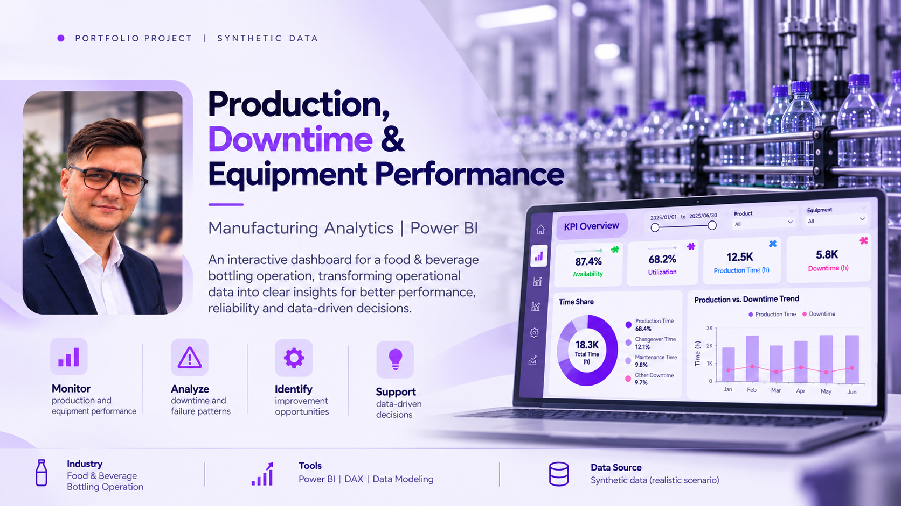
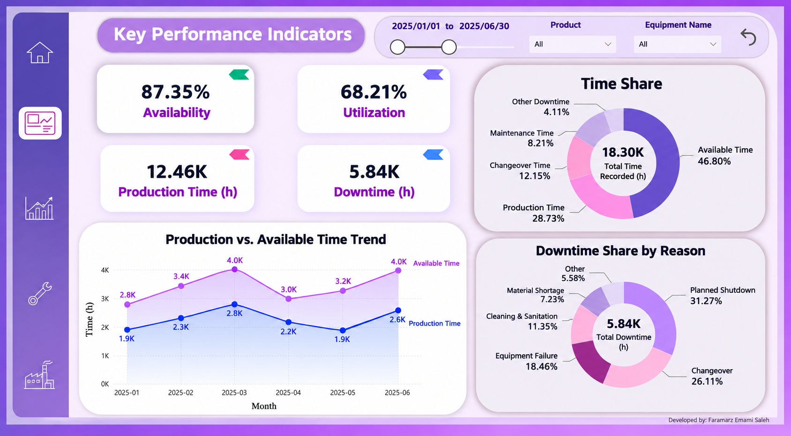
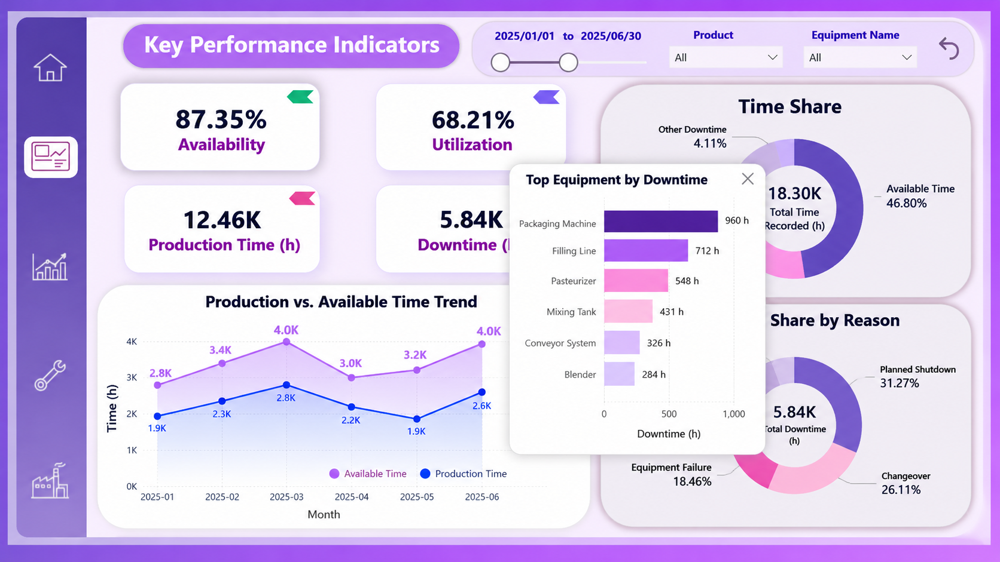
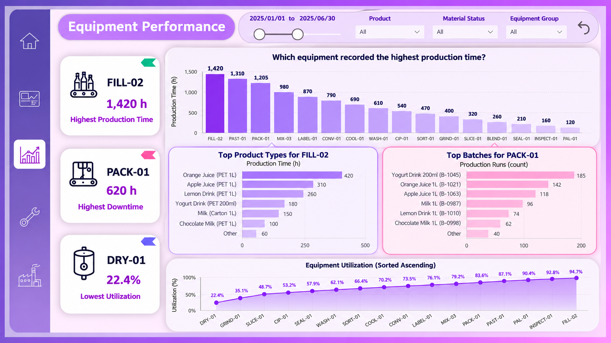
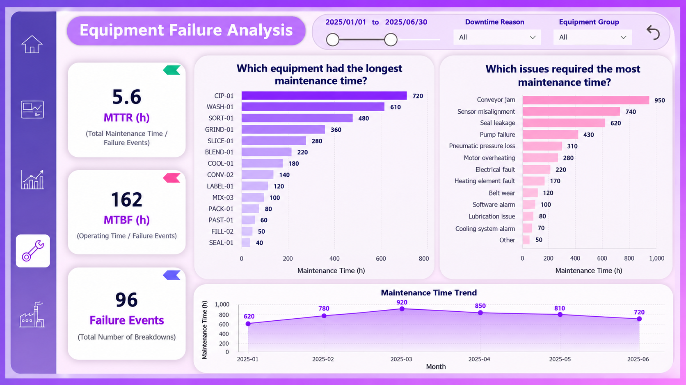
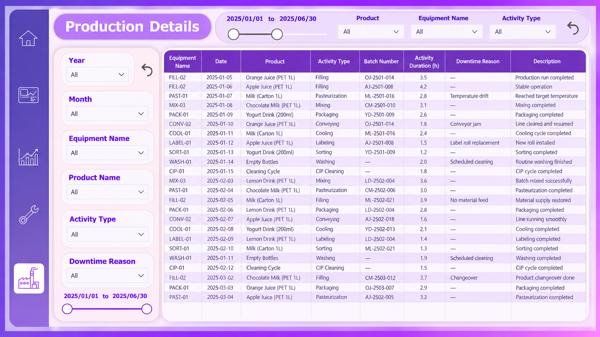

# Production, Downtime & Equipment Performance — Power BI

Interactive Power BI dashboard for a food & beverage bottling operation:
production time, downtime, equipment utilization and failure analysis.

> **Data transparency:** This public version uses a fictional scenario and
> synthetic data. Equipment IDs, products, dates and KPI values are illustrative.
> The analytical framework, KPI selection, DAX measures, layout and design are my own work.
> It is based on a real project in which I collected shop-floor data with operators,
> supervisors and production managers, designed the data-capture file and built
> the original dashboard. No company records are published here.

## Report pages
| Page | What it answers |
|---|---|
| Key Performance Indicators | Availability, utilization, production vs. available time, time share, downtime by reason |
| Equipment Performance | Which equipment produced most, top products/batches, utilization ranking |
| Equipment Failure Analysis | MTTR, MTBF, failure events, maintenance time by equipment and by issue |
| Production Details | Activity-level log with filters (equipment, product, activity, downtime reason) |

## KPIs
- **Utilization** = production time / total recorded time
- **Availability** = share of the time equipment should be available in which it was actually available
- **MTTR** = total maintenance time / failure events
- **MTBF** = operating time / failure events

## Data model
Star schema: one fact table of equipment activities (equipment, date, product,
activity type, batch, duration, downtime reason) with date, equipment, process
and material dimensions.

## Tools
Power BI · DAX · Data modeling

## Screenshots
### Key Performance Indicators

### KPI page with drill-down tooltip

### Equipment Performance

### Equipment Failure Analysis

### Production Details

## Contact
Faramarz Emamisaleh — Nantes, France · faramarz.emami.saleh@gmail.com · [LinkedIn](https://www.linkedin.com/in/faramarz-emamisaleh-229128b9/)
